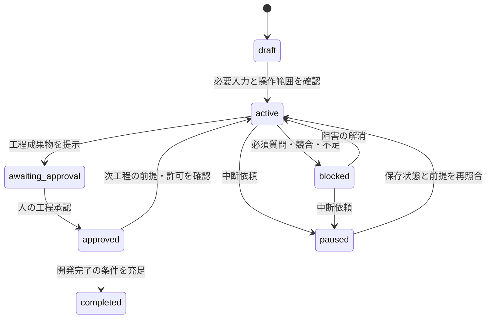

# ワークフロー・エージェント・スキル設計

状態: 設計ドラフト。入力: [ワークフロー要求](../requirements/workflow-orchestration.md)。共通方針: [README.md](README.md)。

## DES-WF-001 対話と工程

外部インターフェースは Copilot Chat の自然言語による依頼と応答である。専用画面・帳票・公開 API は作らない。以下は入力例であり、固定コマンドではない。

| 利用者の意図 | 処理 | 応答 |
| --- | --- | --- |
| 新しい仕組みを考えたい | 受付、既存案件の確認、壁打ち | 目的・候補・対象範囲、現在必要な質問 |
| 要件を整理して | 前工程の合意確認、要件分析 | 成果物参照、未解決事項、承認待ちの工程 |
| 状況を教えて | 保存成果物の読み取りだけ | 現在工程、阻害理由、承認・質問待ち、次の人の操作 |
| 続きから再開して | ブランチ・版・許可・質問・検証の照合 | 再開地点、再開可能な作業、不一致と解消方法 |
| このドラフトをレビューして | 読み取り専用の確認 | 指摘と修正案だけ。保存・実装・承認は行わない |
| この工程を承認します | 対象工程・成果物の版と回答者の確認 | 工程承認の記録。次の操作が許可されているかは別に確認 |
| 止めて | 新規委任を止め、実行中操作の状態を確認 | 保存した再開地点、未完了操作、残作業 |

受付では変更種別 `new` / `enhancement` / `fix`、目的・範囲、既存案件、発注者・技術責任者、操作許可を確認する。名前を推測して承認者を登録しない。同一人物の兼任は可能である。

Git 未初期化でも変更 ID を付けて壁打ちを開始する。ブランチ・基点は未登録のままとし、正式な変更管理の開始前に人の許可と必要な Git 準備を確認する。Git 書き込みの自動経路を利用できない環境では人に準備を依頼し、実際のブランチ・コミットを確認して登録する。工程ごとの別ブランチは作らない。

| 工程キー | 成果物 | 移行条件・承認役割 |
| --- | --- | --- |
| `ideation` | アイデアと採否・範囲 | 必要な質問解消、発注者の工程承認 |
| `requirements` | 要件・業務ルール・非機能・受入条件 | その工程に必要な質問解消、発注者の工程承認 |
| `external-design` | UI・帳票・外部連携、または理由付き対象外判断 | 発注者の工程承認 |
| `internal-design` | 内部構造・データ・処理・運用・テスト方針 | 技術責任者の工程承認 |
| `task-planning` | タスク、検証計画、追跡表、整合性指摘への対応 | 要件・設計との整合、必須の指摘解消。独立した人の承認工程は増やさない |
| `development` | 実装・テスト・結果・独立レビュー | 必要な受入確認、技術責任者の開発完了承認 |

変更のない工程も、参照版・理由・対象外または変更なしの人の承認を記録する。対象外の理由だけで承認を省略しない。設計は外部・内部の区分と既存の承認役割を維持し、各工程の複数文書を一括して承認する。

進行状態は `draft` / `active` / `blocked` / `awaiting-approval` / `approved` / `completed` / `paused` とする。工程キーとは別のフィールドで保存する。



図中の `awaiting_approval` は表示上の別名で、保存値は `awaiting-approval` とする。タスク分解は承認待ちを経ず整合性確認から次工程へ移る。再承認・差し戻しは該当工程を `active` または `blocked` に戻し、以前の結果を履歴として残す。

後工程で決める質問は確認期限の工程と影響を記録する。現在の作業に不要なら壁打ち等を継続できる。承認・工程移行時には、その時点で必須の未解決質問だけを阻害とする。

## DES-WF-002 エージェント構成

8つの custom agent を `.github/agents/` に置く。全役割を毎回起動せず、通常は直列に委任する。必要な場合の並行実行の制約は保持するが、並行実行の動作試験は行わない。

| 設定名 | 責務・主な入力 | 出力・編集範囲 | ツールの役割 |
| --- | --- | --- | --- |
| `sdd-orchestrator.agent.md` | 受付、状態・質問・承認・引き継ぎ管理 | 共有記録と合意した成果物の反映。対象コードを独断で実装しない | 読み取り、担当呼び出し、管理下の更新 |
| `sdd-ideation.agent.md` | 課題・価値・制約から候補と範囲を整理 | アイデア案・質問。該当工程の文書だけ | 読み取り、管理下の文書更新 |
| `sdd-requirements.agent.md` | 承認済みアイデアと既存仕様を分析 | 機能別要件・受入条件・質問 | 読み取り、管理下の文書更新 |
| `sdd-external-design.agent.md` | 承認済み要件から合意すべき外部動作を整理 | UI・帳票・外部連携、対象外理由 | 読み取り、管理下の文書更新 |
| `sdd-internal-design.agent.md` | 承認済み要件・外部設計から内部構成を整理 | DDD・処理・データ・運用・テスト設計 | 読み取り、管理下の文書更新 |
| `sdd-task-planner.agent.md` | 承認済み設計と整合性指摘から作業を分解 | タスク・検証計画・追跡表 | 読み取り、管理下の文書更新 |
| `sdd-implementer.agent.md` | 許可済みタスクと設計から TDD を実施 | 指定コード・テスト、検証証跡 | 読み取り、管理下の編集・検証 |
| `sdd-reviewer.agent.md` | 原本・変更記録・設計・コード・結果を独立確認 | 指摘・未検証・追加タスク案を応答で返す。編集しない | 読み取りだけ。ターミナル・編集・他担当呼び出しなし |

Copilot の `tools` は明示し、省略による既定の全権限を使用しない。読み取りは `read` / `search`、担当呼び出しは `agent`、管理下の操作は `execute` を入口候補とする。具体的なホストツール ID は対応環境で解決する。`execute` は自由なシェル権限ではなく、[ツール設計](tool-integration.md)の固定ランナーだけへ制限する。書き込み担当にも組み込み `edit` を直接付与しない。

全 agent に meaningful な `description` と役割別の停止条件を持たせる。モデル名は固定せず利用者の選択に従い、モデルが変わっても工程・承認・ツール制限は変えない。入口のオーケストレーターだけを通常の選択対象とし、工程担当は `user-invocable: false` とする。スキルは利用者から直接指定可能とする。

共有状態への書き込み責任はオーケストレーターへ集約する。各担当は成果物の差分と質問を返し、許可された工程文書を更新できても、工程承認・質問の解決・タスク完了を独断で確定しない。共有ファイルの更新は補助機能で直列化する。

独立レビューは実装担当とは別の `sdd-reviewer` 呼び出しで行う。サブエージェントが使えない場合は役割切り替えで手順を継続するが、独立確認とは表示しない。実装担当とは異なる人による確認も認め、対象版・確認者・指摘・結果を記録すれば代替完了とする。人の工程承認とは別の記録である。

## DES-WF-003 スキル構成

15スキルを `.github/skills/<name>/SKILL.md` に置く。各フォルダ名と frontmatter の `name` を一致させ、`description` に用途・開始条件を記載する。常時読み込む共通 instructions は短くし、工程別テンプレートは該当スキルの `assets/` に置く。共通データ形式と更新処理は複製しない。

| スキル | 開始条件・必須入力 | 主な出力 | 固有の停止条件 |
| --- | --- | --- | --- |
| `change-intake` | 新規依頼または既存案件指定、利用者の目的 | 変更 ID・種別・範囲・承認役割・Git 準備状況 | 対象案件が複数候補、範囲不明 |
| `workflow-status` | 変更 ID または案件候補 | 現在地・待ち事項・参照・次操作を応答だけで返す | 案件を一意に選べない場合は候補提示 |
| `workflow-resume` | 変更 ID、保存状態、現在の成果物 | 再開地点・不一致・残作業 | ブランチ・版・許可・必須質問の不一致 |
| `clarification` | 未解決質問または新たな疑問、関連工程 | 選択肢・推奨・影響・期限、人の回答と反映案 | 回答が曖昧、影響する承認の扱い不明 |
| `phase-handoff` | 工程成果物・質問・版・承認・許可 | 工程承認の依頼、前提確認、次工程への引き継ぎ | 必須質問・成果物不足・旧版承認 |
| `idea-dialogue` | 目的・制約・仮説。前工程承認は不要 | 候補比較・採否・範囲・質問 | 現在の検討に必要な前提が未確定 |
| `requirements-definition` | 承認済みアイデアまたは変更なしの承認、既存原本 | 要件 ID、非機能、受入条件 | 現在必要な業務判断・範囲が未確定 |
| `external-design` | 承認済み要件 | 外部動作と対象外理由 | 発注者判断が必要な動作が未確定 |
| `ddd-internal-design` | 承認済み要件・外部設計または対象外判断 | 内部構成・依存・データ・技術判断・テスト方針 | 必須の設計判断、既存構成への例外合意が未確定 |
| `change-impact-analysis` | 既存原本・コード・変更案 | 互換性・移行・回帰・再承認対象 | 対象版・依存先が確認できない |
| `canonical-spec-update` | 合意した変更・原本候補・変更記録 | 原本の更新案と対応差分。マージしない | 編集競合、過去の変更記録の書き換え |
| `consistency-review` | 原本候補・変更記録・タスク・追跡表。ドラフト可 | 不足・矛盾・未反映の指摘だけ | 読めない入力は未確認として返す |
| `task-planning` | 承認済み設計と影響分析 | 依存順タスク・TDD または適切な確認方法 | 要件・設計不足、新要件が必要 |
| `tdd-cycle` | 許可済み実装タスク、対象版、検証環境 | Red / Green / Refactor、コード・結果 | 仕様変更、意図しない失敗、実行権限・環境不足 |
| `verification-and-review` | 対象版・受入条件・コード・証跡 | 適合性・独立確認・未実施・残課題 | 必須証拠が欠ける場合は完了を提示しない |

全スキルの共通契約は、入力に変更 ID・工程・対象版・参照・許可範囲を持ち、出力に成果物または差分・観測結果・質問・停止理由・次操作を持つことである。読み取り専用スキルは保存処理を呼ばない。変更を伴う成功は更新結果と新版を確認できた場合だけとし、状態不明は停止して再開手順を返す。

直接指定でも該当工程・操作の前提だけを確認する。壁打ち・質問整理・状況確認・ドラフトレビューを、承認がないという理由だけで停止しない。承認前の実装や前工程不足の設計には進まない。読み取り専用レビューの結果保存は、依頼または合意した範囲でオーケストレーターが別操作として実施する。

## DES-WF-004 委任と引き継ぎ

委任は構造化した参照と短い依頼で行い、会話全文や非公開の思考過程を渡さない。

```json
{
  "changeId": "CHG-0001",
  "phase": "internal-design",
  "branch": "change/CHG-0001",
  "inputRevision": "sha256:example",
  "requirementIds": ["REQ-EXAMPLE-001"],
  "taskIds": [],
  "inputs": ["docs/spec/current/requirements/feature.md"],
  "writeScopes": ["docs/spec/current/design/"],
  "constraints": ["承認しない", "外部操作しない"],
  "expectedOutput": "設計差分・質問・判断根拠・次操作"
}
```

これは形式例であり、本案件の ID・パス・ハッシュではない。返却を受けたオーケストレーターは、返却元・入力版・編集範囲・結果を確認し、実際のファイルと一致しない成功報告を採用しない。質問は窓口へ集約し、複数担当が同じ判断を別々に確定しない。

中断時は新規委任を止め、実行中操作の終了・失敗・結果不明を区別し、最後の確定操作と残作業を保存する。再開は[状態設計](specification-management.md)に従って照合し、必要な場合だけ許可や承認を取り直す。

## 要求との対応

| 要求 | 設計 |
| --- | --- |
| REQ-WF-001 | DES-WF-001。受付、Git 未初期化、1変更1ブランチ。 |
| REQ-WF-002 | DES-WF-001、DES-WF-002。一本の窓口と必要な担当だけの起動。 |
| REQ-WF-003 | DES-WF-002、DES-WF-004。役割別の権限と委任契約。 |
| REQ-WF-004 | DES-WF-001。工程順序、差し戻し、変更なしの承認。 |
| REQ-WF-005 | DES-WF-001。承認役割・兼任・代理記録。 |
| REQ-WF-006 | 工程成果物一式の版と承認記録の分離。具体形式は状態設計。 |
| REQ-WF-007 | DES-WF-001。工程・進行状態・Git 操作を分離。 |
| REQ-WF-008 | DES-WF-001、DES-WF-004。読み取り専用状況確認と中断。 |
| REQ-WF-009 | DES-WF-004。保存成果物からの前提照合と再開。 |
| REQ-WF-010 | DES-WF-003。直接指定の前提とレビュー保存の分離。 |
| REQ-WF-011 | DES-WF-002。役割切り替えと人による独立確認の代替。 |
| NFR-WF-001 | DES-WF-001、DES-WF-004。保存記録から状況を提示。 |
| NFR-WF-002 | DES-WF-002。共有更新の直列化、並行実行は検証対象外。 |