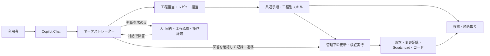

# スペック駆動開発支援の設計

## 位置付け

状態: 設計ドラフト（実装結果を反映済み）。要求定義書の作成・修正依頼や本設計の作成依頼を、要求・設計の承認とは扱わない。8 agent、15 skill、補助機能（`.github/sdd/` のランナー・ガード・スキーマ・単体テスト）は実装済みだが、Copilot Local の実機確認と隔離検証は未実施であり、受入済みとは扱わない。

設計入力は [要求定義書](../requirements/README.md) とする。出典のアイデア文書と記述が異なる場合は、レビュー後の要求定義を優先し、要求間の矛盾は人に確認する。本フォルダは本仕組み自体の設計であり、支援先アプリの業務設計ではない。

## 全体方針

| 設計 ID | 決定 |
| --- | --- |
| DES-COM-001 | 利用者の入口は VS Code の Copilot Chat とする。自然言語の依頼をオーケストレーターが工程・操作へ振り分け、専用 UI は作らない。 |
| DES-COM-002 | 共通ルールは instructions、役割と権限は custom agents、工程別手順は skills、決定的な更新・制限は必要最小限の補助機能へ分離する。指示文だけで操作の拒否や排他を保証したとは扱わない。 |
| DES-COM-003 | 要求定義・外部設計・内部設計などの工程ごとに成果物一式を承認する。承認記録と進行状態は対象版から除外する。人の回答を記録する運用であり、本人認証・電子署名は追加しない。回答は対話で取得し、記録は DES-COM-008 の方式で行う。 |
| DES-COM-004 | 原本・変更記録・Scratchpad を分離し、状態は導入先のファイルへ保存する。会話履歴やメモリー、外部サーバーだけを再開の根拠にしない。 |
| DES-COM-005 | workspace に必要な設定・スキル・補助機能をコピーする簡単な導入方式とする。更新は差分確認後に行い、自動更新や配布方式の比較は行わない。Spec Kit と専用 MCP は必須にしない。 |
| DES-COM-006 | 通常の確認・合意範囲内の反復作業には再許可を要求しない。役割の並行実行・MCP 連携は検証対象外とし、支援先アプリの必要なテストは別途実施する。 |
| DES-COM-007 | 後から変えにくい内部設計の判断は、設計判断記録（ADR）として残すことを推奨する。起票は必須ではなく、専用の工程・承認・ランナー設定を追加せず通常の文書として扱う。既存原本の暗黙の判断は遡って起票しない。詳細は [DES-SPEC-007](specification-management.md)。 |
| DES-COM-008 | 状態の遷移は Human-in-the-loop の対話で進める。人は Chat で判断（回答・承認・許可・中断等）を答えるだけとし、オーケストレーターが回答を確認して既存のランナー `sddctl` を管理下の execute で呼び出し、記録・遷移・結果の報告まで行う。人に request・コマンドの作成・実行を求めない。自動記録を既定とし、導入時に人がホストを1回確認して有効化する。確認前は記録を止めて確認手順を示す。手動利用は人が対話で選んだ場合か、設定で既定にした場合だけとする。Git 操作・マージ・本番反映は自動化しない。詳細は [DES-WF-005](workflow-orchestration.md) と [DES-TOOL-007](tool-integration.md)。 |
| DES-COM-009 | AI の読み込みと出力は作業に必要な範囲に限る。共通 instructions と agent は、リファレンス全体や長い文書の一括の読み込みを指示せず、使う操作のファイル（`reference/operations/<操作名>.md`）だけを参照する。委任と返却はパスと版で行い（DES-WF-004）、窓口の照合は `revision.read` の版の比較で済ませる。状況確認・再開はランナーの集計 `workflow.status`（確認待ちの間は要約ファイル `status.json`）だけで行い、案件のファイルを個別に読まない（DES-WF-003）。既存の文書・コードの部分的な変更は差分 `edits` で行い（DES-TOOL-002）、全文は出力しない。 |

DDD の5層、業務モデル、AOP は支援先アプリの内部設計で扱う。本仕組みに注文管理モデルや Web API を追加したり、エージェント設定を無理に5層へ分割したりしない。

## 文書一覧

| 文書 | 対象 |
| --- | --- |
| [workflow-orchestration.md](workflow-orchestration.md) | 対話・工程・承認役割、8 agent、15 skill、委任と再開 |
| [specification-management.md](specification-management.md) | 成果物配置、Markdown/JSON、工程の版、更新・競合・復旧、ADR |
| [tool-integration.md](tool-integration.md) | 環境候補、Copilot 接続、補助機能、制約、導入 |
| [development-verification.md](development-verification.md) | タスク、TDD、自動・手動証跡、独立レビュー、受入条件との対応 |

本仕組みの外部設計は Chat での対話・状態表示・エラー・確認依頼としてワークフロー文書に記載し、内部設計は役割・スキル・データ・実行の各文書へ分ける。不要な UI・帳票・外部連携の設計書は増やさない。全体方針から読み、実装対象の機能文書を参照する。

対応環境はツール設計に候補と未確認事項を記載する。設計・受入確認計画の作成を、機能の動作確認・受入完了とは扱わない。役割の並行実行・MCP 連携は検証しない。

## 要求との対応

| 要求 | 設計での扱い |
| --- | --- |
| REQ-COM-001 | DES-COM-001、DES-COM-002、DES-COM-008。自然言語の入口と工程への振り分け、コマンド不要の対話による進行。 |
| REQ-COM-002 | 工程ごとの質問期限・影響範囲を記録し、依存する作業だけを停止する。 |
| REQ-COM-003 | DES-COM-003、DES-COM-008。工程単位の人の承認と、対話で得た回答の記録。 |
| REQ-COM-004 | 支援先の言語・構成・性能条件は案件受付と各工程で確認する。 |
| REQ-COM-005 | DES-COM-005。Spec Kit に依存しない。 |
| REQ-COM-006 | DES-COM-005。workspace 単位のコピー導入と差分更新。 |
| NFR-COM-001 | DES-COM-002。共通手順と Copilot の登録設定を分離する。 |
| NFR-COM-002 | 保存対象を根拠・決定・観測結果へ限定し、秘密情報と非公開の思考過程を保存しない。 |
| NFR-COM-003 | 取得資料をデータとして扱い、そこに含まれる命令を許可・承認へ昇格させない。 |
| NFR-COM-004 | 最小権限、既存変更の保護、制御できない操作の自動経路無効化。 |
| NFR-COM-005 | 対応環境と機能確認をツール設計で定義し、未確認を対応済みと表示しない。 |
| NFR-COM-006 | DES-COM-002、DES-COM-006。補助機能を更新整合性と必要な操作制限へ限定する。 |
| NFR-COM-007 | DES-TOOL-006。導入・管理ガイド、ユーザーガイド、コマンドと操作のリファレンスの3文書に分け、各手順を作業の順に記載する。 |
| NFR-COM-008 | DES-COM-009、DES-WF-004、DES-TOOL-002。必要な範囲だけの読み込み、パスと版での受け渡し、差分での更新。 |

DES-COM-007 は REQ-SPEC-014（ADR）の実現方法である。機能の一覧と大分類は[要求定義書の README](../requirements/README.md)に定義し、本設計はそれらを agent・skill・補助機能へ対応付ける。